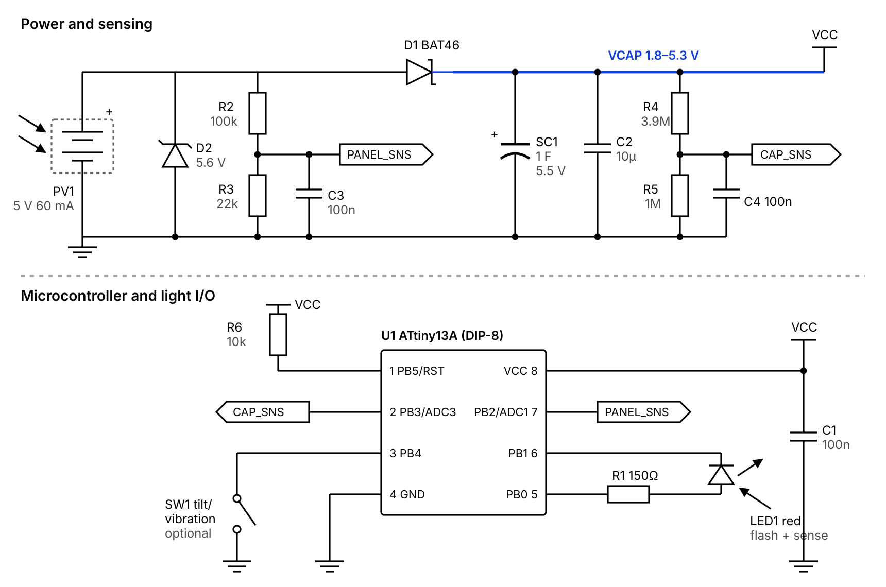

# Firefly

Small, cheap, solar-powered boards that live outdoors and talk to each other with light. Each board charges a supercapacitor during the day. At dusk it wakes up and flashes a red LED, and it watches for its neighbours' flashes with the same LED. Over time the boards fall into sync, like fireflies.

**Target:** about $5 per board, with a home 3D-printed case, an ordered PCB, and through-hole assembly at home.

## Status

Rev 0.1 is a draft. The schematic and BOM are done. The PCB layout and firmware are not started, and nothing has been built or tested yet.

## Hardware at a glance

| Block | Parts | Notes |
| --- | --- | --- |
| MCU | ATtiny13A, DIP-8, socketed | Runs from 1.8–5.5 V. A plain ATtiny13 needs ≥2.7 V |
| Power | 5 V 60 mA panel → BAT46 → 1 F 5.5 V supercap | No battery and no charging IC |
| Clamp | 5.6 V 1 W zener on the panel side | Holds the cap near 5.3 V; no drain at night |
| Light I/O | Red 5 mm water-clear LED between PB0 and PB1 | Drive it forward to flash; reverse-bias it to sense light |
| Sensing | Panel divider → PB2/ADC1, cap divider → PB3/ADC3 | Dusk detection and low-energy shutdown |
| Optional | Vibration switch on PB4 | Wakes the board on a tap or wind |

### Pin map

| Pin | Port | Job |
| --- | --- | --- |
| 1 | PB5 / RESET | 10k pull-up, kept as reset for ISP |
| 2 | PB3 / ADC3 | Cap voltage (3.9M / 1M divider) |
| 3 | PB4 | Optional tilt switch to GND |
| 4 | GND | Ground |
| 5 | PB0 | LED anode through 150 Ω |
| 6 | PB1 | LED cathode / sense input |
| 7 | PB2 / ADC1 | Panel voltage (100k / 22k divider) |
| 8 | VCC | VCAP rail, 100 nF at the pin |

### Rough energy budget (estimates, to be checked on the bench)

- Usable energy, 5.3 V → 1.8 V on 1 F: about 12 J
- Time to fill in full sun: about 1.5 min
- Run time flashing every 3 s: about 12 h
- Run time asleep with no flashing: about 4 days

## Cost

About **$3.57 per board** for the parts you buy, or **$4.57** if you also buy the MCU. See [`hardware/bom.csv`](hardware/bom.csv). Prices are estimates for 20–50 boards, and the solar panel is the item most worth shopping around for.

## Files

- `hardware/schematic.html`: annotated schematic page with the pin map, energy budget and layout notes
- `hardware/schematic.png`: the schematic as an image
- `hardware/bom.csv`: bill of materials

## Notes before layout

- Socket U1 and program the chips off-board. The LED sits between MOSI and MISO, which can upset in-circuit programming.
- Fuses: 128 kHz or 1.2 MHz clock, BOD at 1.8 V, with BOD disabled during sleep in firmware.
- The internal 1.1 V reference is only accurate to ±10%, so calibrate ADC thresholds per board or leave margin.
- Outdoors: use a PETG or ASA case (not PLA), conformal-coat the board, and leave a drain hole under the panel.

## Roadmap

- [ ] KiCad schematic and PCB (~35×35 mm)
- [ ] Firefly sync firmware (MicroCore / avr-gcc)
- [ ] Enclosure STL
- [ ] Bench test of the energy budget
