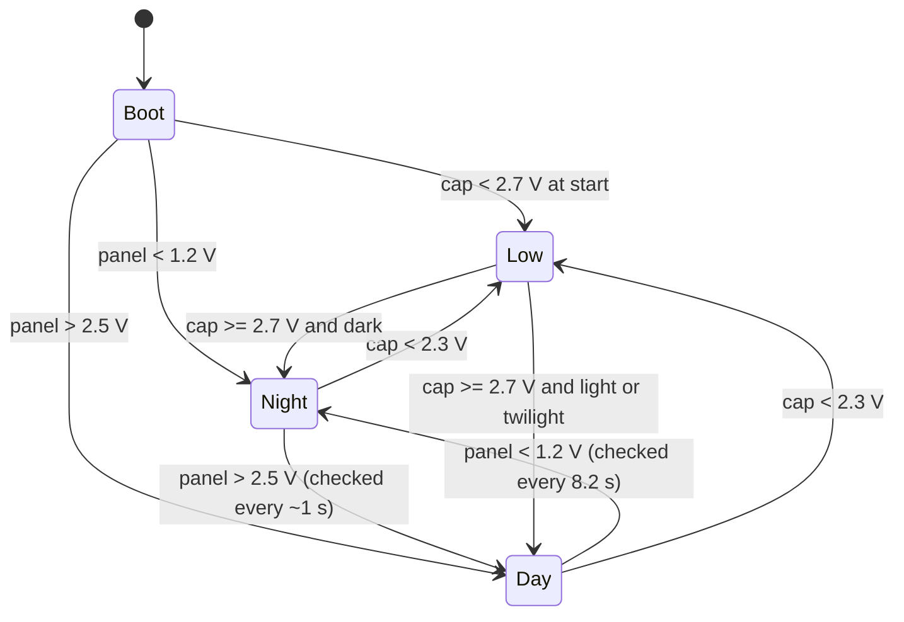
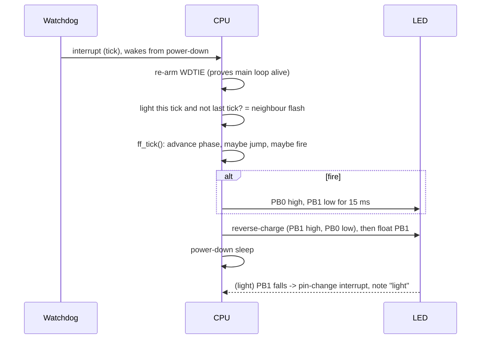

# Firmware design

How the Firefly firmware works and why it is built this way. The requirements it implements are in [requirements.md](requirements.md); requirement IDs appear in brackets.

## At a glance

- **One timebase: the watchdog.** The chip spends almost all its time in power-down sleep. The watchdog interrupt wakes it every 32 ms at night and every 8.2 s by day. There are no timers or busy loops, apart from the 15 ms flash.
- **The LED is the light sensor.** Between ticks the LED is charged in reverse and its cathode left floating. Light (photocurrent) discharges it, and a pin-change interrupt notes that this happened.
- **Synchronisation is a pulse-coupled oscillator** in `firefly.c`, which is pure C and tested on the host.
- **Day, night and energy** come from two ADC readings, once a second at night and every 8.2 s by day.

| Resource | Used | Available |
| --- | --- | --- |
| Flash | 792 bytes | 1024 |
| Static RAM | 4 bytes | 64 |
| Stack (deepest seen in simulation) | 8 bytes | |
| Pins | PB0–PB4 (PB5 kept as RESET) | 6 |

## Files

| File | What it does |
| --- | --- |
| `src/config.h` | Every tunable number: tick, period, coupling, flash length, thresholds in mV (converted to ADC counts at compile time) |
| `src/firefly.h/.c` | Synchronisation algorithm. No hardware access; the host tests compile it unchanged |
| `src/main.c` | Hardware: sleep, watchdog, ADC, LED flash and sense, tap switch, mode logic |

## Modes



| Mode | Wake-up | What happens |
| --- | --- | --- |
| Night | every 32 ms | sync tick, flash if due, re-arm the LED sensor; ADC check every 31 ticks |
| Day | every 8.2 s | ADC check only; LED idle (both ends low) |
| Low | every 8.2 s | ADC check only; taps ignored |

Thresholds have hysteresis: the panel switches at 1.2 V and 2.5 V, the supercap at 2.3 V and 2.7 V [FW-PWR-1..3]. A cold start in the supercap's 2.3–2.7 V band stays silent until the cap reaches 2.7 V.

## A night tick



### Sensing light with the LED [FW-SENSE-1, -2]

A reverse-biased LED is a small capacitor (tens of pF) in parallel with a photodiode. After charging it to VCC and letting the cathode float, photocurrent from light at the LED's own colour or shorter discharges it. A neighbour's red flash a metre away gives roughly nanoamps, enough to pull PB1 below the logic threshold within a few milliseconds. In darkness the leakage is picoamps, so the pin stays high for far longer than one 32 ms tick.

The firmware never measures the discharge time. It only asks "did it discharge before the next tick?" That costs almost no awake time, because the pin-change interrupt does the watching while the CPU sleeps.

- When PB1 falls, the interrupt records `g_light` and drives PB1 low, so a slowly falling input never sits half-way and draws current through the input buffer.
- Only a dark → light change counts as a flash [FW-SENSE-2]. Steady ambient light makes every tick "light", so nothing is counted and the board keeps its own rhythm (test IT-11).
- **Order matters when re-arming** (defect DR-4). The interrupt is disabled and PB1 set high *before* PB1 becomes an output. Otherwise the pin glitches low and the board "sees" its own re-arm on every tick.

### Synchronisation [FW-SYNC-1..5]

Each board counts `phase` from 0 to 77 (one count per tick). At 78 it flashes, returns to 0, and ignores light for 34 ticks (the refractory window). When a neighbour flash is seen outside that window:

```
phase = phase + phase/2 + 3      # then +1 for the tick itself; >= 78 means flash now
```

The jump grows with the phase, so a board that was almost ready flashes immediately ("absorption"), and a board early in its cycle is nudged a little. This is the Mirollo–Strogatz model of firefly synchrony with a linear phase response.

The constants were chosen by search, not by hand:

1. `test/param_sweep.c` simulates two boards in lock-step from all 78 × 78 start phases for 432 combinations of jump and refractory length. 82 combinations always end synchronised. The first-draft constants (jump phase/4 + 2, refractory 13) did not: some start pairs settle into a stable anti-phase pattern (defect DR-1). [Results](results/param-sweep.md).
2. `test/swarm.c` compares the short-listed settings with up to 30 boards, ±10–20 % clock spread and missed detections. The shipped setting syncs fastest and most reliably in every scenario. [Results](results/swarm.md).

**Latency:** a board can only react on the tick after it sees a flash, so synchronised boards flash up to one tick (32 ms) apart. That is below what the eye separates. In a chain of boards that can only see their neighbours, the lag adds up per hop (about 100 ms across 8 boards in a line).

### Tap switch [FW-TAP-1, -2]

PB4 has its internal pull-up enabled and a pin-change interrupt. A tap wakes the CPU at once (not on the next tick). At night the board flashes immediately and restarts its cycle, which its neighbours then follow. Pin-change interrupts on PB4 are then disabled for 31 ticks (~1 s) to ignore spring rattle. If SW1 isn't fitted, the pull-up keeps PB4 high and the feature costs nothing.

### Watchdog and robustness [FW-SAFE-1, -2]

- The WDT runs in *interrupt and reset* mode. The hardware clears the interrupt-enable bit when the interrupt fires, and the main loop sets it again on every tick. If the main loop ever stops, the next timeout resets the chip.
- A watchdog reset leaves the watchdog enabled at its shortest timeout. `main()` clears `MCUSR` and disables the WDT first, and starts it only after the 0.3 s boot flashes. Starting it earlier caused a reset loop at power-up (defect DR-2, found in simulation).
- Pin-change wake-ups (light, tap) are **not** ticks. Only the WDT interrupt sets `g_tick`; other wake-ups go straight back to sleep (defect DR-3).

## Energy budget

These are estimates. The datasheet-typical values marked † must be confirmed on the bench (BT-04, BT-05).

| Item (night, VCC 3.5 V) | Calculation | Average current |
| --- | --- | --- |
| Power-down with WDT on † | datasheet typical, order of 4 µA | 4 µA |
| CPU awake for tick work | 0.4 mA † × 0.45 % (simulated) | 1.8 µA |
| CPU awake during flash | 0.4 mA × 0.60 % | 2.4 µA |
| LED flash | (3.5 − 1.9 V) / 175 Ω ≈ 9 mA × 15 ms / 2.5 s | 54 µA |
| Supercap divider (R4 + R5) | 3.5 V / 4.9 MΩ | 0.7 µA |
| Supercap leakage † | part-dependent | ~3 µA |
| **Total** | | **≈ 66 µA** |

- **Night run time:** from 5.3 V to the 2.3 V cut-off the supercap gives Q = 1 F × 3.0 V = 3 C, and 3 C / 66 µA ≈ 12.6 h. LED current falls as the voltage drops, which helps; the supercap's −20 % tolerance hurts. Expect 10–14 h.
- **By day:** about 8 µA, which any daylight easily covers.
- **Charging:** 1 F × 5.3 V at the panel's 60 mA takes about 90 s in full sun, and about 30 min at 5 % (heavy overcast).

The main ways to stretch the night are a shorter `FLASH_MS`, a longer `FF_PERIOD`, or a larger supercap.

## Timing accuracy

The watchdog oscillator is accurate to about ±10 % and drifts with temperature and voltage, so a board's period is 2.5 s ± 0.25 s. The sync algorithm is what keeps a group together. The swarm simulation covers ±10 % and ±20 % spreads. The 15 ms flash uses the 1.2 MHz RC oscillator (±10 % factory calibration), which is accurate enough for a flash.

## Tuning

All tunables are in `src/config.h`. After changing any of them, run `make check test`. The unit tests, parameter sweep and swarm simulation re-check the sync constants; the simulator tests re-check timing.

| Want | Change |
| --- | --- |
| Brighter or longer flash | `FLASH_MS` (energy grows in proportion) |
| Slower rhythm | `FF_PERIOD`, keeping `FF_REFRACTORY` ≈ 44 % of it; re-run `make -C test sweep` |
| Earlier or later dusk | `PANEL_NIGHT_MV` / `PANEL_DAY_MV` (calibrate with BT-08) |
| Run deeper into the night | `CAP_LOW_MV` (keep ≥ 2.1 V for BOD and LED headroom) |
| No tap feature | nothing: an unfitted SW1 costs nothing |
