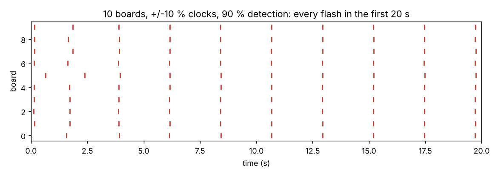
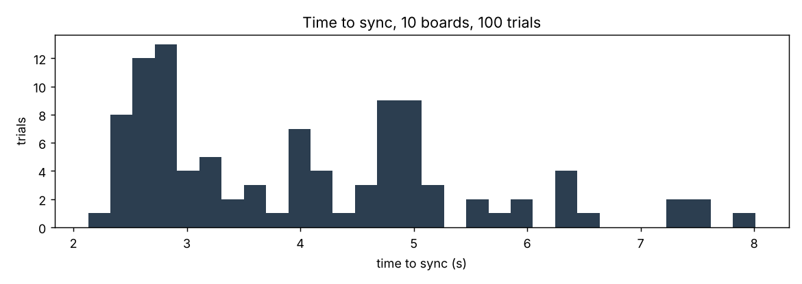

# Swarm simulation results

Generated by `test/swarm_report.py`: 100 random trials per row, 600 s each. Each board runs the real `src/firefly.c` with its own watchdog clock (uniform within the drift shown), a random start time and a random start phase. A board sees a neighbour's flash with the detection probability shown.

- **synced**: trials that reached 5 volleys in a row in which every board flashed within the sync window (100 ms for all-see-all; plus 40 ms per extra hop across the network).
- **time to sync**: from power-up to the first of those 5 volleys.
- **steady**: share of volleys in the second half of the trial that were in sync.
- **spread**: median time from first to last flash in a volley.

## Shipped constants (shipped: jump 1/2 + 3, refractory 34)

| Scenario | Synced | Time to sync: median | p95 | max | Steady: median | worst trial | Spread (median) |
| --- | --- | --- | --- | --- | --- | --- | --- |
| 2 boards | 100/100 | 2.3 s | 16.8 s | 20.5 s | 95.5 % | 89.0 % | 18 ms |
| 10 boards, all see all | 100/100 | 4.0 s | 7.2 s | 8.0 s | 100.0 % | 100.0 % | 30 ms |
| 30 boards, all see all | 100/100 | 4.7 s | 7.9 s | 13.7 s | 100.0 % | 100.0 % | 32 ms |
| 10 in a ring | 100/100 | 5.0 s | 19.9 s | 42.1 s | 97.7 % | 86.3 % | 92 ms |
| 16 in a 4x4 grid | 100/100 | 5.1 s | 10.2 s | 16.4 s | 99.2 % | 95.5 % | 74 ms |
| 8 in a line | 100/100 | 7.0 s | 27.8 s | 36.1 s | 93.0 % | 61.8 % | 104 ms |
| 10 all, 50 % of flashes missed | 100/100 | 3.9 s | 7.2 s | 10.8 s | 100.0 % | 98.5 % | 38 ms |
| 10 all, +/-20 % clocks | 100/100 | 4.8 s | 12.6 s | 54.1 s | 100.0 % | 100.0 % | 31 ms |
| 10 all, ideal (no drift, no misses) | 100/100 | 2.9 s | 5.6 s | 6.2 s | 100.0 % | 100.0 % | 30 ms |

## Alternatives considered

Same scenarios, other constants (see `test/param_sweep.c` for the lock-step search that short-listed them).

| Constants | Scenario | Synced | Time to sync: median | p95 | Steady: worst trial |
| --- | --- | --- | --- | --- | --- |
| shipped: jump 1/2 + 3, refractory 34 | 10 boards, all see all | 100/100 | 4.0 s | 7.2 s | 100.0 % |
| shipped: jump 1/2 + 3, refractory 34 | 30 boards, all see all | 100/100 | 4.7 s | 7.9 s | 100.0 % |
| shipped: jump 1/2 + 3, refractory 34 | 10 in a ring | 100/100 | 5.0 s | 19.9 s | 86.3 % |
| shipped: jump 1/2 + 3, refractory 34 | 16 in a 4x4 grid | 100/100 | 5.1 s | 10.2 s | 95.5 % |
| shipped: jump 1/2 + 3, refractory 34 | 8 in a line | 100/100 | 7.0 s | 27.8 s | 61.8 % |
| alt: jump 1/4 + 6, refractory 36 | 10 boards, all see all | 100/100 | 5.1 s | 9.4 s | 100.0 % |
| alt: jump 1/4 + 6, refractory 36 | 30 boards, all see all | 100/100 | 4.8 s | 9.1 s | 100.0 % |
| alt: jump 1/4 + 6, refractory 36 | 10 in a ring | 100/100 | 8.4 s | 21.4 s | 88.5 % |
| alt: jump 1/4 + 6, refractory 36 | 16 in a 4x4 grid | 100/100 | 8.1 s | 15.3 s | 97.0 % |
| alt: jump 1/4 + 6, refractory 36 | 8 in a line | 100/100 | 10.8 s | 37.1 s | 55.6 % |
| first draft: jump 1/4 + 2, refractory 13 | 10 boards, all see all | 100/100 | 8.3 s | 18.8 s | 100.0 % |
| first draft: jump 1/4 + 2, refractory 13 | 30 boards, all see all | 100/100 | 11.1 s | 18.7 s | 100.0 % |
| first draft: jump 1/4 + 2, refractory 13 | 10 in a ring | 100/100 | 17.5 s | 50.9 s | 40.4 % |
| first draft: jump 1/4 + 2, refractory 13 | 16 in a 4x4 grid | 100/100 | 17.5 s | 42.1 s | 88.8 % |
| first draft: jump 1/4 + 2, refractory 13 | 8 in a line | 100/100 | 21.2 s | 61.5 s | 16.6 % |

## Plots

