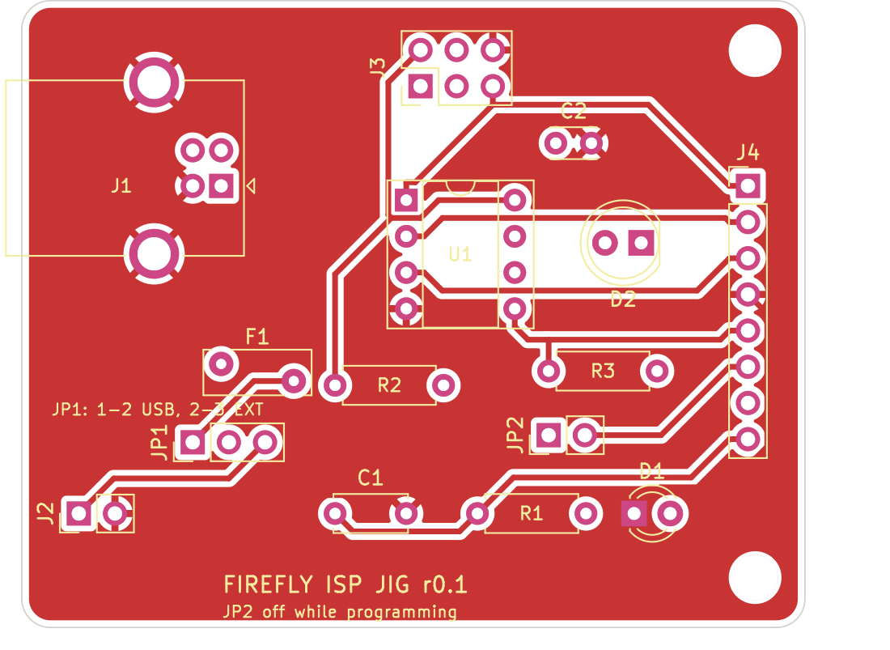
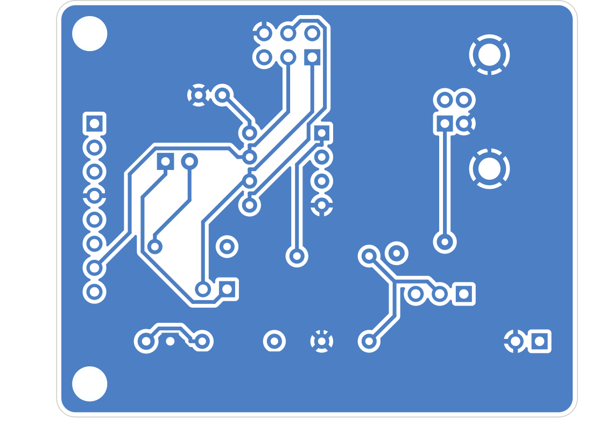
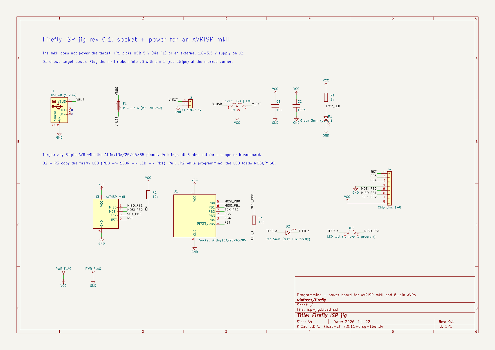

# ISP jig

A small through-hole board that holds an 8-pin AVR, powers it, and connects it to an **Atmel AVRISP mkII**. Each chip goes into the socket, gets flashed, and then moves to a firefly board.



## Why it exists

- **The AVRISP mkII doesn't power the chip.** It only senses the target's voltage, so this jig supplies power: USB 5 V through a resettable fuse, or anything from 1.8 to 5.5 V on J2. JP1 picks which.
- **The firefly board has no programming header.** On that board the LED sits across MOSI and MISO and a capacitor loads SCK, so the chips are programmed here instead.
- **You can test firmware on the bench.** D2 and R3 copy the firefly LED wiring (PB0 → 150 Ω → LED → PB1), so you can watch the flash and sense code work before a chip goes outside. J4 brings out all 8 pins for a scope or breadboard.

## Board

- 55 × 44 mm, two layers, all through-hole, two M3 holes
- DRC passes with no errors and no unconnected pads. The one warning is the USB socket's outline crossing the board edge, which is intentional: its mouth hangs over the edge.
- Gerbers: `fab/isp-jig-rev0.1-gerbers.zip`. Schematic: `fab/isp-jig-schematic.pdf`. Parts: `bom.csv` (about $0.80 in parts plus the PCB).

| Front | Back |
| --- | --- |
|  |  |



## Jumpers and connectors

| Part | Setting | What it does |
| --- | --- | --- |
| JP1 | 1-2 | Power the chip from USB 5 V (J1, through F1) |
| JP1 | 2-3 | Power the chip from J2 (1.8–5.5 V, e.g. 2×AA to mimic the supercap) |
| JP2 | fitted | Test LED connected, for running firmware |
| JP2 | open | **Required while programming.** The LED would load MOSI and MISO |
| J3 | — | AVRISP mkII 6-pin cable. The red stripe (pin 1) goes to the square pad |
| D1 | — | Lights when the chip has power |

## Using it with the AVRISP mkII

1. Set JP1 to USB and remove JP2.
2. Put the ATtiny13A in the socket with pin 1 (the dot) toward the notch.
3. Plug in USB power (D1 lights), then the mkII cable. The mkII's status LED turns green when it sees target power.
4. Check the connection:

   ```sh
   avrdude -c avrispmkII -P usb -p t13 -B 8
   ```

   It should print the signature `0x1e9007`.

5. Flash:

   ```sh
   avrdude -c avrispmkII -P usb -p t13 -B 8 -U flash:w:firefly.hex:i
   # or, from firmware/:  make flash
   ```

6. To test the firmware on the jig, fit JP2. The jig has no panel or supercap, so set the two sense pins on J4 with resistors: 10 kΩ from pin 2 to pin 8 (supercap OK) and 10 kΩ from pin 7 to pin 4 (night), or to pin 8 (day). The red LED then runs as it would on a firefly board. Without the resistors those pins float and the mode is unpredictable.

**Programming speed.** `-B` sets the programming clock period in microseconds. It has to stay slower than a quarter of the chip's clock:

| Chip clock | Use |
| --- | --- |
| 1.2 MHz (factory default) | `-B 8` or slower |
| 128 kHz (firefly low-power setting) | `-B 64` or slower |

If a chip stops answering right after a fuse change, it has usually just been slowed down. Retry with a bigger `-B`.

**Drivers.** On macOS and Linux avrdude finds the mkII as is (on Linux you may need a udev rule or `sudo`). On Windows, use Zadig to install the WinUSB or libusb-win32 driver for "AVRISP mkII", because avrdude can't use Atmel's old Jungo driver.

**Arduino IDE.** Install the MicroCore board package, select ATtiny13, and set the programmer to "AVRISP mkII". Then use *Burn Bootloader* (this only sets the fuses) and *Upload Using Programmer*.

## Regenerating

The schematic and board are generated from `kicad/design.py`. See [`tools/kicadgen`](../../tools/kicadgen/README.md).
